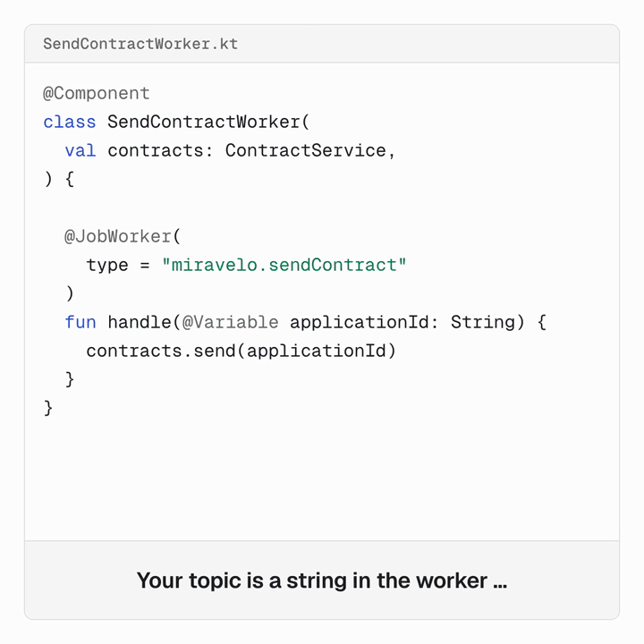
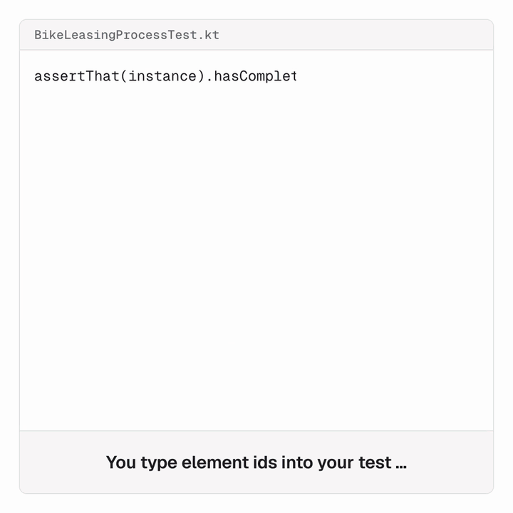

# bpmn-to-code

[](https://plugins.gradle.org/plugin/io.miragon.bpmn-to-code-gradle)
[](https://central.sonatype.com/artifact/io.miragon/bpmn-to-code-maven)
[](https://github.com/Miragon/bpmn-to-code/releases/latest)
[](https://hub.docker.com/r/miragon/bpmn-to-code-web)
[](LICENSE)


**Rename a task in the modeler, and your build tells you which code still uses the old name.**

bpmn-to-code generates a typed Process API from your BPMN models, so your workers, engine calls and tests reference element ids, job types and message names as constants instead of strings.

## Why

A worker with its job type as a string, like `@JobWorker(type = "miravelo.sendContract")`, keeps compiling when the model renames it, and the process instance just waits. With the generated constant, the build fails at the worker:

```kotlin
@JobWorker(type = ServiceTasks.MIRAVELO_SEND_CONTRACT)
fun sendContract() { ... }
```



## What you get

- **One typed API per process.** Signals, errors and variables too, see [Generated API](https://miragon.github.io/bpmn-to-code/guide/generated-api).
- **Models checked before code is written.** Built-in rules stop the generation on a missing job type or message name, see [Validation](https://miragon.github.io/bpmn-to-code/validate/).
- **Your own modeling rules as tests.** On the JVM, `bpmn-to-code-testing` runs the built-in rules and your own in JUnit, see [Testing module](https://miragon.github.io/bpmn-to-code/validate/testing).
- **No lock-in.** Plain constants and objects, independent of engine, worker library and test framework.
- **Process tests that stop compiling instead of failing at runtime.** [`ProcessPath`](https://miragon.github.io/bpmn-to-code/guide/process-path) builds the expected path from generated flow nodes.



## Supported engines and languages

| Engine            | `processEngine` |
| ----------------- | --------------- |
| Camunda 8 / Zeebe | `ZEEBE`         |
| Camunda 7         | `CAMUNDA_7`     |
| Operaton          | `OPERATON`      |

| Language                  | `outputLanguage` | Generated by                                                                     |
| ------------------------- | ---------------- | -------------------------------------------------------------------------------- |
| Kotlin                    | `KOTLIN`         | Gradle plugin, Maven plugin, CLI, web app                                        |
| Java                      | `JAVA`           | Gradle plugin, Maven plugin, CLI, web app                                        |
| C# (experimental)         | `CSHARP`         | [MSBuild during `dotnet build`](https://miragon.github.io/bpmn-to-code/getting-started/dotnet), CLI, web app, Gradle and Maven plugins |
| TypeScript (experimental) | `TYPESCRIPT`     | [npm script](https://miragon.github.io/bpmn-to-code/getting-started/typescript), CLI, web app, Gradle and Maven plugins |

The NuGet and npm packages are not yet published; until then, use the CLI, the web app or the build plugins for C# and TypeScript.

## Install

Your project needs Java 21 or newer, the target of the plugins and the runtime.

**Gradle**

<!-- x-release-please-start-version -->
```kotlin
plugins {
    id("io.miragon.bpmn-to-code-gradle") version "7.0.1"
}
```
<!-- x-release-please-end -->

With the `java` plugin applied, it also adds `bpmn-to-code-runtime`, the types the generated code imports.

**Maven**

<!-- x-release-please-start-version -->
```xml
<dependencies>
    <dependency>
        <groupId>io.miragon</groupId>
        <artifactId>bpmn-to-code-runtime</artifactId>
        <version>7.0.1</version>
    </dependency>
</dependencies>

<build>
    <plugins>
        <plugin>
            <groupId>io.miragon</groupId>
            <artifactId>bpmn-to-code-maven</artifactId>
            <version>7.0.1</version>
            <executions>
                <execution>
                    <phase>generate-sources</phase>
                    <goals><goal>generate-bpmn-api</goal></goals>
                </execution>
            </executions>
            <configuration>
                <baseDir>${project.basedir}</baseDir>
                <filePattern>src/main/resources/*.bpmn</filePattern>
                <outputFolderPath>${project.basedir}/src/main/java</outputFolderPath>
                <packagePath>com.example.process</packagePath>
                <outputLanguage>JAVA</outputLanguage>
                <processEngine>ZEEBE</processEngine>
            </configuration>
        </plugin>
    </plugins>
</build>
```
<!-- x-release-please-end -->

**Without Gradle or Maven**

- **Command line:** `brew install miragon/tap/bpmn-to-code` or a release zip, see [bpmn-to-code-cli](bpmn-to-code-cli/README.md).
- **Web app:** [in the browser](https://bpmn-to-code.miragon.io/static/index.html), or self-hosted from the [Docker image](https://hub.docker.com/r/miragon/bpmn-to-code-web).

## Get started

With Gradle and Kotlin:

1. Point the generation task at your models in `build.gradle.kts`:

   ```kotlin
   import io.miragon.bpmn.adapter.GenerateBpmnModelsTask
   import io.miragon.bpmn.domain.shared.OutputLanguage
   import io.miragon.bpmn.domain.shared.ProcessEngine

   tasks.named("generateBpmnModelApi", GenerateBpmnModelsTask::class) {
       baseDir = "."
       filePattern = "src/main/resources/**/*.bpmn"
       outputFolderPath = "src/main/kotlin"
       packagePath = "com.example.process"
       outputLanguage = OutputLanguage.KOTLIN
       processEngine = ProcessEngine.ZEEBE
   }
   ```

2. Run `./gradlew generateBpmnModelApi` after a model change; it is not part of `build` unless you [wire it in](https://miragon.github.io/bpmn-to-code/getting-started/gradle).
3. Replace the strings in your workers and tests with the constants in `com.example.process`.

With Maven, run `mvn generate-sources` on the configuration above.

More in the [Gradle guide](https://miragon.github.io/bpmn-to-code/getting-started/gradle), the [Maven guide](https://miragon.github.io/bpmn-to-code/getting-started/maven), [Configuration](https://miragon.github.io/bpmn-to-code/guide/configuration) and [Verify in CI](https://miragon.github.io/bpmn-to-code/guide/verify-in-ci).

## With your AI assistant

For Kotlin and Java, the Claude Code plugin sets up the generator and writes workers, engine calls and tests against the Process API, see [Agent Skills](https://miragon.github.io/bpmn-to-code/skills/):

```text
/plugin marketplace add Miragon/bpmn-to-code
/plugin install bpmn-to-code@bpmn-to-code
```

## Help and feedback

- **Documentation:** every feature, option and limit at [miragon.github.io/bpmn-to-code](https://miragon.github.io/bpmn-to-code/).
- **Upgrading:** release notes and migration guides in the [changelog](https://miragon.github.io/bpmn-to-code/changelog/).
- **Bugs and ideas:** [open an issue](https://github.com/Miragon/bpmn-to-code/issues).

## Contributing

How to build, test and change the project is in [CONTRIBUTING.md](CONTRIBUTING.md). We do not accept external pull requests.

## License

[MIT](LICENSE) © Marco Schäck. Built and maintained by [Miragon](https://miragon.io).
