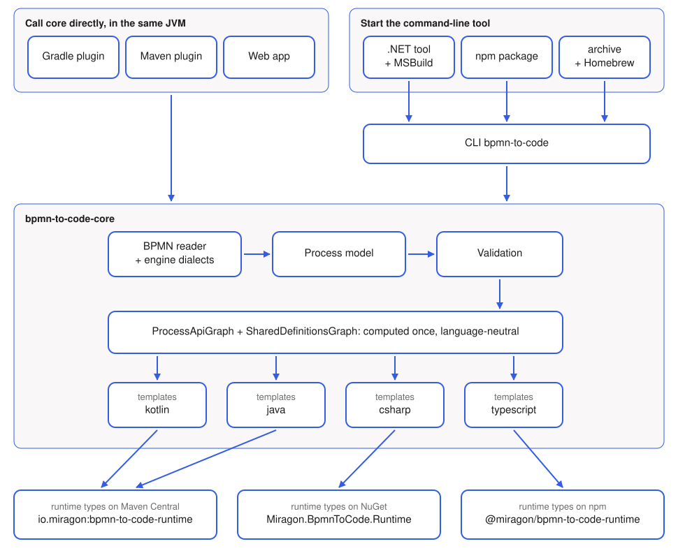

# Languages and Ecosystems

How one Kotlin core writes four languages and reaches the JVM, .NET and Node. The reasons are recorded in [ADR 007](./adr/007-output-languages) and [ADR 014](./adr/014-command-line-tool); modules and layers are on [Architecture](./architecture).



## Two ways into core

Every language is written in core; an entry point only chooses one.

- **Directly.** The Gradle plugin, the Maven plugin and the web app run on the JVM anyway and call core's `*Plugin` classes in their own process.
- **Through the command-line tool.** Everything outside the JVM starts the CLI `bpmn-to-code`, which calls the same `*Plugin` classes. The .NET and npm packages contain no generator, only the CLI jars and a launcher that starts them on Java 21 from `JAVA_HOME` or the `PATH`:

| Package | Launcher | How a project uses it |
|---|---|---|
| `Miragon.BpmnToCode` | `Program.cs` of a .NET tool | `dotnet tool exec`, or the MSBuild package, which runs it before the project compiles and brings the runtime of the same version |
| `@miragon/bpmn-to-code` | `launcher.js`, registered under `bin` | `bpmn-to-code generate-api …` in a `package.json` script; the runtime is a peer dependency of exactly the same version |
| Release archive, Homebrew | `bin/bpmn-to-code` | Anywhere else; the archive bundles its own Java runtime (jlink) |

## Per language

| Language | Rendered by | Runtime types | Generated in its ecosystem by | Checked by |
|---|---|---|---|---|
| Kotlin | `builder/jvm`, `templates/kotlin` | `io.miragon:bpmn-to-code-runtime` (Maven Central) | Gradle or Maven plugin | Golden files; compiled in `NestedSubProcessCompilationTest` |
| Java | `builder/jvm`, `templates/java` | `io.miragon:bpmn-to-code-runtime` (Maven Central) | Gradle or Maven plugin | Golden files; compiled in `JavaProcessApiBuilderTest` |
| C# | `builder/csharp`, `templates/csharp` | `Miragon.BpmnToCode.Runtime` (NuGet) | `Miragon.BpmnToCode.MSBuild` during `dotnet build`, or the .NET tool `Miragon.BpmnToCode` | Golden files; `dotnet test` in `packages/nuget/BpmnToCode.Runtime.Tests` |
| TypeScript | `builder/typescript`, `templates/typescript` | `@miragon/bpmn-to-code-runtime` (npm) | `@miragon/bpmn-to-code` in an npm script | Golden files; `npm test` in `packages/npm/bpmn-to-code-runtime` |

A builder maps the language-neutral graph to a template model and handles keywords, escaping and imports; the FreeMarker template writes the code around it. Every language renders its flow nodes from the same `FlowNodeModel`, which `FlowNodeMapper` builds; a language only supplies a `FlowNodeSyntax` that writes literals, names and references. `CodeGenerationAdapter` picks the builders of a language from one map. Kotlin and Java share the builders in `builder/jvm`; a `JvmLanguage` holds what sets them apart: syntax, templates, implicit imports and doc comments.

## Where the parts live

```text
bpmn-to-code-core/src/main/
├─ kotlin/io/miragon/bpmn/adapter/outbound/codegen/
│  ├─ flow/, definitions/            language-neutral graphs
│  ├─ flownode/                      flow node model and mapper
│  ├─ rendering/                     FreeMarker setup, the only code that knows FreeMarker
│  └─ builder/{jvm,csharp,typescript}/   graph → template model, syntax, imports
└─ resources/io/miragon/bpmn/codegen/templates/<language>/   FreeMarker templates
bpmn-to-code-core/src/test/resources/api/   golden files per language
bpmn-to-code-runtime/                       runtime types for Kotlin and Java
bpmn-to-code-cli/                           command-line tool and its archives
packages/nuget/                             BpmnToCode.Runtime (+ .Tests), BpmnToCode.Tool, BpmnToCode.MSBuild
packages/npm/                               bpmn-to-code-runtime (+ test/), bpmn-to-code
```

## Build and release

| Workflow | What it does |
|---|---|
| `build-backend.yml` | Runs the Gradle build on the JVM alone and smoke-tests the CLI archive |
| `build-packages.yml` | When core, the CLI or `packages/` change: builds the CLI and runs the package tests, which generate C# and TypeScript with it and compile and run them against the runtime packages |
| `publish-cli.yml` | Builds and starts one archive per platform and attaches it to the release |
| `publish-homebrew.yml` | Updates the formula in `Miragon/homebrew-tap` for a stable release |
| `publish-to-nuget.yml` | Packs the three NuGet packages, smoke-tests tool and MSBuild, pushes them only once the repository variable `PUBLISH_NUGET` is `true` |
| `publish-to-npm.yml` | Stages both npm packages, smoke-tests them on three operating systems, publishes them only once `PUBLISH_NPM` is `true` |

`release-please.yml` calls all of them; every artifact carries the one version of `gradle.properties` ([ADR 011](./adr/011-compatibility-policy)). Details in [Releasing](./releasing).

## Adding a language

1. A value in `OutputLanguage`, which Gradle, Maven and the CLI accept from then on, and an option in the form of the web app.
2. A package `builder/<language>` with a `FlowNodeSyntax`, and a folder `templates/<language>`, registered in `CodeGenerationAdapter`.
3. Golden files under `src/test/resources/api/`, and tests next to the runtime package that compile the output with the language's own compiler.
4. A runtime package in the language's registry, if the output refers to runtime types, and a package that starts the CLI there.
5. A getting-started page and a line in [ADR 007](./adr/007-output-languages).
