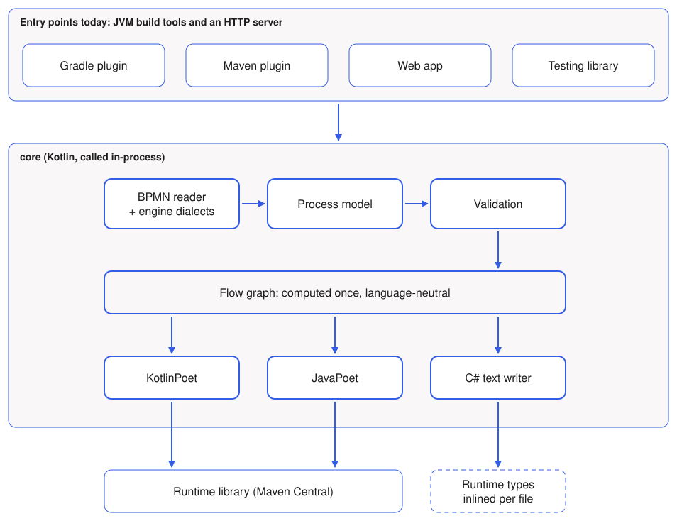
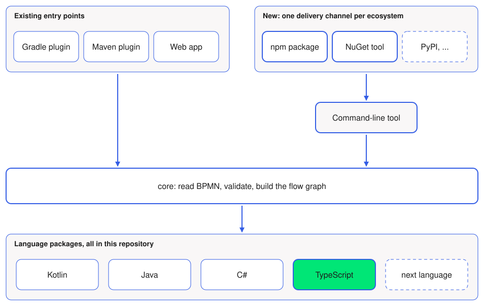

# Concept: Target Languages and Environments

::: info Decided, being built
The direction is decided: core stays Kotlin and writes every language from templates, a command-line tool is put in front of it, TypeScript is the first new language and ships through npm. What is built is recorded in the [ADRs](../adr/) as it lands; this concept keeps the reasoning and the options that were turned down.
:::

How bpmn-to-code could reach teams outside the JVM. This page is the overview; every topic has its own page with the details.

## Who this is for

Today the generator runs inside a Gradle or Maven build, or behind the web app. That fits JVM teams. It does not fit:

- a .NET team that writes workers in C# and has no JDK, Gradle or Maven
- a Node team that writes workers in TypeScript and works with `package.json` scripts
- a frontend team that builds no workers but needs the process steps, for example to show the name of the step an order is in

All three want the same thing: files that are generated during their own build, in their own language, started with their own tooling. Changing how the generated API looks is not a goal.

## Where we are



| Fact | Consequence |
|---|---|
| Every entry point is a JVM build tool or an HTTP server | A C# user needs a JDK plus Gradle or Maven, or has to call the web API |
| The flow graph is computed once and rendered per language ([ADR 007](../adr/007-output-languages)) | A new language is a new renderer, not a new pipeline |
| C# is already written as plain text, without a poet library | The way to render a language that has no such library exists and works |
| The shared definition files have no common model, each language reads the domain itself | That gap has to close before a fourth language is added |
| There is no command-line entry point | Nothing outside a build tool can start the generator |

## Where this goes



Core stays what it is. A command-line tool is put in front of it, and each ecosystem gets a thin package that installs and starts that tool.

## What a team would see

For a TypeScript team this would look as follows.

```json
{
  "scripts": {
    "generate": "bpmn-to-code generate --baseDir bpmn --filePattern *.bpmn --processEngine ZEEBE --outputLanguage TYPESCRIPT --outputFolderPath src/process"
  }
}
```

```ts
import { BikeLeasing } from "./process/bikeLeasing";

// a worker
zeebe.createWorker({ taskType: BikeLeasing.jobTypes.validateApplication /* ... */ });

// a frontend
const step = BikeLeasing.flowNodes.serviceTask_validateApplication;
showLabel(step.name); // "Validate application"
```

## What is settled in principle

These points came out of the discussion that led to this concept. They shape every page that follows.

1. **Generation happens at build time.** The tool reads `.bpmn` files and writes source files, which the project then imports. Calling the generator as a library at runtime, or running it in a browser, is not a goal.
2. **Every target language is a fixed package in this repository.** We build and maintain it. There is no plugin interface for third parties and no public intermediate format they could generate from.
3. **Users do not customise the output.** One language, one shape. No user templates, no template overrides.
4. **Every language delivers at least constants and information.** More is optional, see [tiers](./language-package#tiers).
5. **Every language brings the delivery channel of its ecosystem.** TypeScript ships through npm, C# through NuGet, and so on.

## The pages

| Page | Answers | State |
|---|---|---|
| [The language package](./language-package) | What a target language consists of, where its parts live in the repository, which tiers there are, whether it needs a runtime library | pattern settled; TypeScript writes its runtime types once per run |
| [Where the code is written](./generation) | Whether core writes the code of every language, or hands out a model and lets each environment write its own | decided: core writes every language (A) |
| [Delivery channels](./delivery) | How an npm or NuGet package can start a tool that is not written in JavaScript or C#, and how Java travels along | decided: npm first, with a bundled Java runtime (B1); NuGet later |
| [The language of core](./core-language) | Whether core should move to Go, Node or Kotlin Multiplatform | decided: core stays Kotlin (A1) |
| [Writers](./writers) | How the code of every language is rendered: Kotlin code or template files | decided: FreeMarker templates for every language, Kotlin and Java included |
| [Ideas for configuration](./configuration) | Five ways to configure the tool, from flags to a `bpmn-to-code.json`, each compared with tools that work that way | decided: flags only (1) for now, the model (5) stays policy |
| [Further changes](./repository) | What else changes in core and in the release, and which ADRs this touches | follows from the choices |

One question belongs to none of these pages: does C# leave its experimental state before TypeScript starts?
