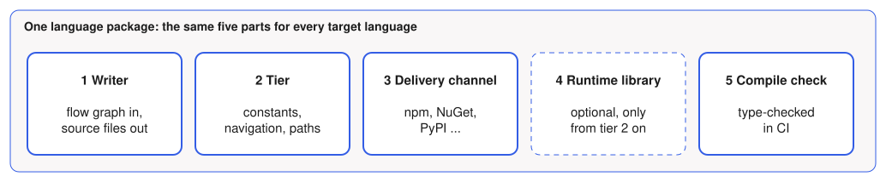

# The Language Package

A target language is always the same five parts. Adding a language means filling in this list, nothing else.



| Language | Writer | Delivery channel | Runtime library | Compile check |
|---|---|---|---|---|
| Kotlin | KotlinPoet | Gradle plugin, Maven plugin | Maven Central | Kotlin compiler |
| Java | JavaPoet | Gradle plugin, Maven plugin | Maven Central | `javac` |
| C# | templates | NuGet (`dotnet tool`, MSBuild package) | NuGet `Miragon.BpmnToCode.Runtime` | `dotnet build` |
| TypeScript | templates | npm | npm `@miragon/bpmn-to-code-runtime` | `tsc --strict` |
| Python (example) | text writer | PyPI | open | `mypy` or `pyright` |

## Where the parts live in the repository

A language package is not one folder. Its parts sit where parts of that kind already sit today, so a new language adds a folder in each of these places.

```text
bpmn-to-code-core/
  src/main/kotlin/.../adapter/outbound/codegen/
    flow/                    the flow graph, shared by all languages
    builder/kotlin/          writer
    builder/java/            writer
    builder/csharp/          writer
    builder/typescript/      writer                                   (new)
  src/test/resources/api/    expected output per language
  src/test/kotlin/.../codegen/
    CSharpCompilationTest    compile check
    TypeScriptCompilationTest  compile check                          (new)

bpmn-to-code-cli/            the command-line tool, a Gradle module   (new)

bpmn-to-code-gradle/         delivery channel for Kotlin and Java
bpmn-to-code-maven/          delivery channel for Kotlin and Java
bpmn-to-code-runtime/        runtime library for Kotlin and Java

packages/                    everything published outside the JVM     (new)
  npm/
    bpmn-to-code/            delivery channel: package.json and launcher
    platform/                one package per operating system, filled by the release build
  nuget/
    BpmnToCode.Tool/         delivery channel: the dotnet tool
```

| Part | Where | What a new language adds |
|---|---|---|
| Writer | `builder/<language>/` in core | A folder with its writers, and one entry in `OutputLanguage` and in `CodeGenerationAdapter` |
| Tier | The [output languages table](/guide/configuration#output-languages) of the user guide | A row that says what the language offers |
| Delivery channel | `packages/<registry>/` | A thin package, see [delivery channels](./delivery). A language whose ecosystem already has one adds nothing: JavaScript would reuse the npm package of TypeScript |
| Runtime library | `bpmn-to-code-runtime` for the JVM, `packages/<registry>/` otherwise | Only from tier 2 on |
| Compile check | Next to the existing compilation tests in core | A test that compiles or type-checks the generated files, and the toolchain for it in CI |

The folders under `packages/` are not Gradle modules. They are built and published by the tooling of their own ecosystem, the way `docs` and `tools` already are.

This layout assumes that core writes the code of every language. What changes if each environment writes its own is on [where the code is written](./generation).

The alternative would be one folder per language that holds everything. It reads well, but the writers need core's internal flow graph, so they would either stay in core anyway or force core to open that model to other modules.

## Tiers

Kotlin and Java offer three things today. A new language does not have to offer all of them, but it has to say which.

| Tier | Contains | Needs a runtime library | Kotlin / Java | C# | New languages |
|---|---|---|---|---|---|
| 1 Constants and information | Process id, element ids and names, job types, messages, signals, errors, variables | no | yes | yes | required |
| 2 Navigation | Which element follows which, typed | depends on the language | yes | yes | optional |
| 3 Paths | Assertions over a path through the process in tests | yes | yes (`ProcessPath`) | no | optional |

Tier 1 covers the worker and the frontend case. It is also the tier that costs least to keep alive: no library to publish, no version of generator and runtime to keep in step.

## Runtime libraries beyond the JVM

Only relevant for a language that goes beyond tier 1. TypeScript takes a middle way: its runtime types are written once per generation run, as one more shared file next to the shared definitions. Nothing is published, and the generated files of one run share their types.

| Option | What it means | Consequence |
|---|---|---|
| E1 No library, types inlined | As C# was until the runtime package | Nothing to publish. Types of two generated files are unrelated, and the files are long |
| E2 One library per ecosystem | npm, NuGet, PyPI | Clean for users. Each one is a package to publish, version and keep in step with the generator |

**Decided: E2** for C# and TypeScript, so both get `ProcessPath` and one set of types across all Process APIs ([ADR 008](../adr/008-runtime-library-and-process-paths)).

Back to the [overview](./).
